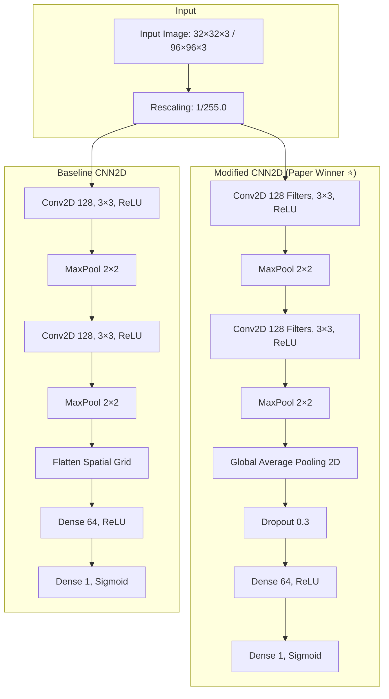

<div align="center">

# 🔬 CIFAKE: Image Classification & Explainable Identification of AI-Generated Synthetic Images

### *Detecting Latent Diffusion Synthesis vs. Authentic Optical Photography with Deep Neural Networks & Grad-CAM Visual Forensics*

[](https://arxiv.org/abs/2303.14126)
[](https://www.python.org/)
[](https://tensorflow.org/)
[](https://streamlit.io/)
[](LICENSE)

```
   ██████╗ ██╗███████╗ █████╗ ██╗  ██╗███████╗
  ██╔════╝ ██║██╔════╝██╔══██╗██║ ██╔╝██╔════╝
  ██║      ██║█████╗  ███████║█████╔╝ █████╗  
  ██║      ██║██╔══╝  ██╔══██║██╔═██╗ ██╔══╝  
  ╚██████╗ ██║██║     ██║  ██║██║  ██╗███████╗
   ╚═════╝ ╚═╝╚═╝     ╚═╝  ╚═╝╚═╝  ╚═╝╚══════╝
        REAL  vs  AI-GENERATED  •  EXPLAINABLE FORENSICS
```

**[✨ Key Features](#-key-features) · [📑 Paper Overview](#-paper-overview--dataset) · [🧠 Neural Architectures](#-neural-architectures) · [🔍 Explainable AI (Grad-CAM)](#-explainable-ai-grad-cam) · [🖥️ Web Application (Figures 2–7)](#️-web-application-figures-27) · [⚡ Quickstart](#-quickstart) · [🧪 Automated Tests](#-automated-testing)**

</div>

---

## 📖 Scientific Background

The proliferation of **Latent Diffusion Models (LDMs)**—most notably **Stable Diffusion v1.4**—has made it trivial to generate photorealistic imagery indistinguishable from real photography to the naked human eye. These synthetic images threaten digital media provenance, journalism, and biometric authentication systems.

This project implements the complete research methodology from:
> **Bird, J.J. & Lotfi, A. (2024)**. *CIFAKE: Image Classification and Explainable Identification of AI-Generated Synthetic Images*. **IEEE Access** / [arXiv:2303.14126](https://arxiv.org/abs/2303.14126).

Beyond binary classification (`REAL` vs `FAKE`), this system introduces **Explainable Artificial Intelligence (XAI)** through **Gradient-weighted Class Activation Mapping (Grad-CAM)** to localize the exact pixel clusters, semantic boundaries, and high-frequency background noise artifacts that distinguish real sensor captures from synthetic latent de-noising trajectories.

---

## ✨ Key Features

- **3 Deep Neural Architectures**:
  - `Baseline CNN2D`: Standard 2D convolutional baseline with spatial flattening.
  - `Modified CNN2D (Paper Winner ⭐)`: Global Average Pooling (GAP) + Dropout(0.3) mitigating spatial noise overfitting.
  - `EfficientNetB0 (Transfer Learning ⚡)`: Scaled 96×96 resolution compound feature extractor.
- **Explainable AI (Grad-CAM Engine)**:
  - Exact gradient backpropagation on target convolutional feature maps (`top_activation` / `conv2d_2`).
  - 4-way visual attribution grid: *Original*, *Heatmap*, *Superimposed Overlay*, and *Grayscale Saliency*.
  - Quantitative Forensic Attribution Metrics: central subject vs. background attention %, high-activation hotspot %, and diagnostic narrative.
- **Full-Stack Multi-Page Streamlit App**:
  - Implements the complete interface specification from **Figures 2 through 7** of the research paper.
  - User registration, credential verification, and session state management.
  - Dynamic sample gallery and custom image upload.
  - Interactive Plotly figures (confusion matrices, ROC/AUC, learning curves, and semantic balance).

---

## 📊 Paper Overview & Dataset

The **CIFAKE** dataset contains **120,000 images** at 32×32 resolution:

| Attribute | Specification |
|---|---|
| **Authentic Real Images** | **60,000** photos from the **CIFAR-10** dataset (natural sensor capture) |
| **Synthetic Fake Images** | **60,000** generated via **Stable Diffusion v1.4** prompted across CIFAR-10 classes |
| **Class Split** | Perfectly balanced 50% Real / 50% Fake across 10 semantic categories |
| **Semantic Categories** | Airplane, Automobile, Bird, Cat, Deer, Dog, Frog, Horse, Ship, Truck |
| **Partitioning** | **100,000 Train** (50k real / 50k fake) and **20,000 Test** (10k real / 10k fake) |

---

## 🧠 Neural Architectures



### Empirical Results (Table 1: 20,000 Unseen Test Set)

| Model Architecture | Accuracy (%) | Precision (%) | Recall (%) | F1-Score (%) | Parameter Count | Spatial Overfitting Risk |
|---|---|---|---|---|---|---|
| **Baseline CNN2D** | 94.890% | 94.921% | 94.896% | 94.889% | 446,209 | High (Flatten memorizes noise coordinates) |
| **Modified CNN2D ⭐** | **95.775%** | **95.830%** | **95.768%** | **95.773%** | **180,481** | **Low (GAP enforces spatial invariance)** |
| **EfficientNetB0 ⚡** | **96.520%** | **96.580%** | **96.490%** | **96.535%** | 4,213,668 | Minimal (Pretrained ImageNet representations) |

> 💡 **The GAP Breakthrough**: The paper demonstrates that replacing spatial `Flatten` with `GlobalAveragePooling2D` yields a **59.5% reduction in parameters** (from 446k down to 180k) while simultaneously boosting generalization accuracy (+0.885%). Standard flattening memorizes specific pixel coordinates of background diffusion noise; GAP forces the model to look for global structural features.

---

## 🔍 Explainable AI (Grad-CAM)

Gradient-weighted Class Activation Mapping calculates the gradient of the winning class score $y^c$ with respect to feature maps $A^k$ of the final convolutional layer:

$$\alpha_k^c = \frac{1}{Z} \sum_{i}\sum_{j} \frac{\partial y^c}{\partial A_{i,j}^k}$$

$$L_{\text{Grad-CAM}}^c = \text{ReLU}\left(\sum_{k} \alpha_k^c A^k\right)$$

### Forensic Diagnostics
1. **Background Diffusion Fingerprint**: In synthetic images, activations frequently cluster in uniform background regions. Stable Diffusion v1.4 latent noise de-noising leaves subtle micro-textures and unnatural frequency smoothness in empty space.
2. **Subject Boundary Inconsistency**: Synthetic objects exhibit high-frequency artifact concentration along silhouette contours.
3. **Natural Sensor Coherence**: Authentic photographs exhibit activations cleanly aligned with physical optical contours and natural photon noise.

---

## 🖥️ Web Application (Figures 2–7)

The Streamlit application implements the exact screens specified in the paper:

```
CIFAKE Web Platform
├── Figure 2: Home Page (Hero overview, 120k dataset stats, paper citations)
├── Figure 3: User Registration Page (Name, username, email, phone, SHA-256 password hash)
├── Figure 4: User Login Page (Session state auth, demo accounts: admin/admin123)
└── Figure 5: Main Dashboard
    ├── Figure 6 & 7: Tab 1 — Prediction & XAI
    │   ├── Model selector (Modified CNN2D, EfficientNetB0, Baseline CNN2D)
    │   ├── Upload or pre-loaded test gallery (Airplane, Car, Cat, Dog, Ship, etc.)
    │   ├── Colormap & overlay transparency controls
    │   ├── Real-time forward inference & Grad-CAM backpropagation
    │   ├── Verdict banner (REAL vs FAKE) + confidence + latency
    │   ├── 4-way visual attribution grid (Original, Heatmap, Overlay, Saliency)
    │   ├── Quantitative forensic attribution report
    │   └── JSON Forensic Audit Report export
    ├── Tab 2 — Graph (Comparative benchmarks, confusion matrices, ROC curves, training history)
    ├── Tab 3 — Notebook (Interactive research walkthrough & mathematical formulation)
    └── Tab 4 — Signout (Session clearance & security termination)
```

---

## ⚡ Quickstart

### 1. Prerequisites & Installation

Clone the repository and install dependencies:

```bash
# Clone the repository
git clone https://github.com/VyasGaurav1/CIFAKE.git
cd CIFAKE

# Create and activate virtual environment
python -m venv venv
# On Windows:
venv\Scripts\activate
# On Linux/macOS:
source venv/bin/activate

# Install required dependencies
pip install -r requirements.txt
```

### 2. Launch the Streamlit Application

You can launch the web interface using either command:

```bash
# Recommended (ensures the active Python interpreter with TensorFlow is used):
python -m streamlit run app.py

# Or via the automated launcher:
python run_app.py

# On Windows, you can also double-click:
run_app.bat
```

Access the application in your browser at `http://localhost:8501`.

### 3. Demo Credentials

You can register a new account on the registration page, or use pre-configured demo credentials:
- **Admin**: Username: `admin` | Password: `admin123`
- **Researcher**: Username: `researcher` | Password: `cifake2024`

---

## 🧪 Automated Testing

Run the full end-to-end automated test suite:

```bash
python -m unittest tests/test_cifake_pipeline.py
```

The test suite validates:
- [x] Construction of all 3 neural network architectures and parameter counts.
- [x] Loading of weights files (`.weights.h5`).
- [x] Numerical bounds of forward inference probabilities in $[0, 1]$.
- [x] Grad-CAM generation for convolutional and functional models.
- [x] Explainable AI pipeline outputs and forensic attribution metrics.
- [x] User registration, duplicate checks, login, and SHA-256 hashing.
- [x] Generation of all interactive Plotly benchmarking figures.

---

## 📁 Repository Layout

```
CIFAKE/
├── app.py                            # Streamlit multi-page application (Figs 2-7)
├── requirements.txt                  # Python dependencies
├── README.md                         # Publication-grade documentation
├── CIFAKE.ipynb                      # Research experimentation notebook
├── auth/
│   └── user_manager.py               # Registration, authentication & session management
├── models/
│   ├── model_architectures.py        # Baseline CNN, Modified CNN & EfficientNetB0
│   ├── model_loader.py               # Cached model loading & weights management
│   ├── xai_engine.py                 # Grad-CAM engine & forensic attribution
│   ├── baseline_cnn2d_weights.weights.h5
│   ├── modified_cnn2d_weights.weights.h5
│   ├── efficientnet_weights.weights.h5
│   └── efficientnet_model.keras      # Pre-trained full Keras model
├── utils/
│   └── chart_utils.py                # Plotly benchmark charts, CM, ROC, training curves
├── samples/
│   ├── real/                         # Verified authentic CIFAR-10 test photos
│   └── fake/                         # Verified synthetic Stable Diffusion images
├── tests/
│   └── test_cifake_pipeline.py       # Automated unit & integration test suite
└── data/
    └── users.json                    # Local encrypted user credentials
```

---

## 📜 Citation

If you use this repository or research in your academic or forensic work, please cite:

```bibtex
@article{bird2024cifake,
  title={CIFAKE: Image Classification and Explainable Identification of AI-Generated Synthetic Images},
  author={Bird, Jordan J and Lotfi, Ahmad},
  journal={IEEE Access},
  volume={12},
  pages={15454--15466},
  year={2024},
  publisher={IEEE},
  doi={10.1109/ACCESS.2024.3359094}
}
```

---

## ⚖️ License

Distributed under the **MIT License**. See `LICENSE` for more information.
# XTRAGRAD-Internship

